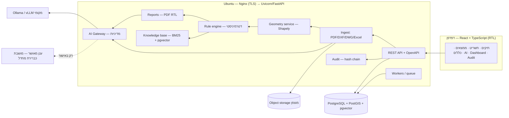
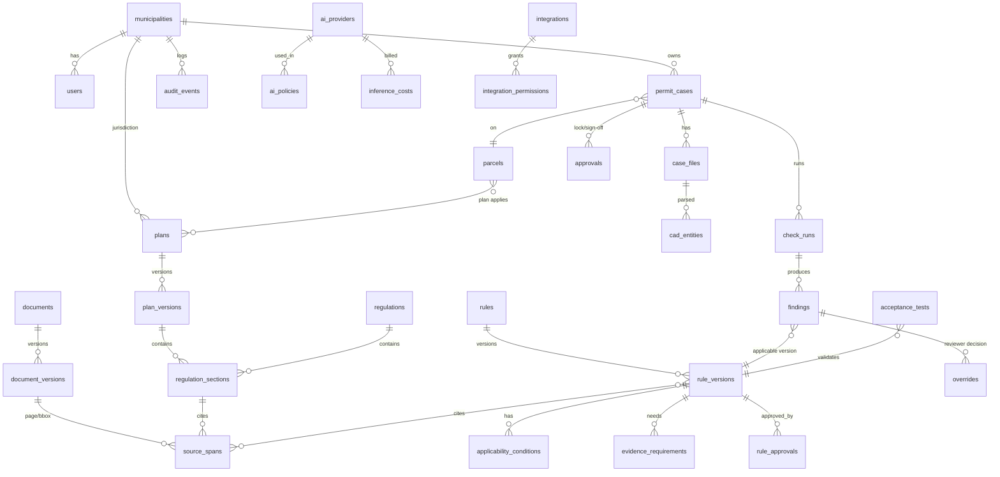

# 03 — SRS, ארכיטקטורה, ERD ומרשם סיכוני אבטחה/פרטיות/קניין רוחני

## 1. SRS — דרישות מערכת (תמצית)

### 1.1 תחום
מערכת תומכת החלטה לבדיקת בקשות לתוספות בנייה בבני ברק (פיילוט מכרז 7/26). קלט: קבצי PDF, DWG/DXF, Excel, Offline. פלט: דוח שלמות, דוח זכויות, דוח בודק — **המלצה בלבד**.

### 1.2 שחקנים ותפקידים
מנהל מערכת · מהנדס העיר · מנהל אגף · בודק תכניות · מתכנן/עורך בקשה · מזכירות · גורם חיצוני מאושר (מפרט §13.2). מטריצת הרשאות: `backend/app/security.py`.

### 1.3 דרישות פונקציונליות

| מזהה | דרישה | מימוש POC |
|---|---|---|
| FR-01 | פתיחת תיק עם סוג בקשה, מסלול, שלב, גוש/חלקה, אזור, תכניות חלות | `POST /api/cases` |
| FR-02 | קליטת קובץ: אימות סיומת מול תוכן (magic bytes), גודל, SHA-256, כפילות, גרסה, AV (ClamAV אם מותקן) | `ingest/files.py` |
| FR-03 | PDF: טקסט + תיבות מילים לכל עמוד, טבלאות, זיהוי עמודים סרוקים (NEEDS_OCR), זיהוי שדה חתימה | `ingest/pdf.py` |
| FR-04 | DXF: יחידות ($INSUNITS) או יחידה מוצהרת; שכבות; LWPOLYLINE/POLYLINE עם bulge, LINE, ARC, CIRCLE; פירוק בלוקים; דיווח XREF; ללא יחידות ⇒ חסימת מדידה | `ingest/cad.py` |
| FR-05 | DWG: המרה ל־DXF דרך ODA File Converter; ללא ממיר ⇒ NEEDS_CONVERSION (לא מודדים מתמונה) | `cad.convert_dwg` |
| FR-06 | Excel: טבלת שטחים לפי מילים נרדפות, קיים/מוצע, עיקרי/שירות | `ingest/excel.py` |
| FR-07 | מדידות דטרמיניסטיות במטרים: שטחים לפי תפקיד שכבה, מרחקים מינימליים, חריגה ממעטפת קווי בניין | `geometry.py` |
| FR-08 | מנוע כללים: תחולה → מדידה → השוואה עם אי-ודאות → gating לפי מצב אישור → סתירות | `rules/engine.py` |
| FR-09 | שלושה דוחות + PDF עברי RTL + תשריט עם סימון | `reports.py` |
| FR-10 | החלטת בודק לכל ממצא (אישור/דחייה עם נימוק), נעילת גרסה | `/api/findings/*`, `/workflow` |
| FR-11 | אישור מקצועי של כלל (מהנדס עיר/מנהל אגף) — רק לכלל עם מקור מאומת | `/api/rules/{id}/approval` |
| FR-12 | בסיס ידע עם אחזור ומקור לכל תוצאה | `knowledge.py` |
| FR-13 | AI Gateway עם מדיניות מקומי/ענן/היברידי | `ai/gateway.py` |
| FR-14 | Dashboard: סטטוסים, עומס, SLA, ממצאים, עלויות AI, זמני ריצה | `/api/dashboard` |
| FR-15 | Audit משורשר hash | `audit.py` |
| FR-16 | ייצוא פתוח (JSON) של תיק, ריצות וממצאים | `/api/cases/{id}/export` |

### 1.4 דרישות לא-פונקציונליות
ביצועים לפי מפרט §11.1 (≤10 ש׳ פעולה; ≤60 ש׳ דוח); זמינות 99.5%; עברית מלאה RTL; נגישות (תוויות, ניגודיות, ניווט מקלדת); ריבוי רשויות עם בידוד; הפרדת סביבות; לוגים ומדדים.

### 1.5 עקרונות מחייבים (מיושמים בקוד ובבדיקות)
1. אין פסילה אוטומטית מכלל שלא אושר מקצועית (`RULE_NOT_APPROVED` ⇒ UNCERTAIN).
2. חוסר נתונים ⇒ INCOMPLETE/UNCERTAIN, לעולם לא "לא חוקי".
3. הנחיה איכותנית לא הופכת למספר שרירותי.
4. סתירת מקורות ⇒ ממצא CONFLICT לבודק, ללא הכרעה.
5. LLM אינו מחשבון ואינו מכריע חוקיות.
6. כל ממצא — מקור, סעיף, עמוד, מצב אימות.

## 2. ארכיטקטורה

**POC בפועל:** SQLite במקום PostgreSQL (הסכמה המלאה ל־PostgreSQL/PostGIS: `db/postgres_schema.sql`), עיבוד סינכרוני (מהיר מספיק — ~0.1 ש׳ לתיק הדגמה), אחסון קבצים בתיקייה מקומית. ללא Docker — בהתאם להנחיה; פריסת Ubuntu עם systemd + Nginx (`deploy/`).

### 2.1 השוואת ארכיטקטורות AI

| קריטריון | A. מקומית מלאה (Ollama/vLLM + Tesseract על שרת עירוני/ענן ישראלי פרטי) | B. היברידית (מקומי למסמכי תיק; ענן מאושר במחוז IL למשימות ללא מידע אישי) | C. ענן מלא |
|---|---|---|---|
| אבטחה/פרטיות | **5** — מידע לא יוצא | 4 — מידע אישי נשאר מקומי; תלוי בהסכם ספק ענן | 2 — דורש אישור מראש וחשש אימון |
| עלות | 3 — GPU (≈ 40–90 אלף ₪ חד-פעמי או שכירות GPU בענן ישראלי) | **4** — GPU קטן + שימוש לפי צריכה (בתקרת 300 אלף ₪/שנה, סע׳ 13.5) | 3 — לפי צריכה, תלוי נפח |
| Latency | 4 — ללא רשת חיצונית; תלוי GPU | 4 | 3 |
| דיוק (OCR עברי, ראייה) | 3 — מודלים פתוחים חלשים יותר בעברית/שרטוטים | **4** — מודלי ענן חזקים למשימות לא-רגישות | 5 |
| עמידה במכרז (§4.2, §13.4, ה4) | **5** | 4 — דורש אישור כתוב | 2 |
| **המלצה** | ברירת מחדל לפיילוט | יעד לאחר אישור הרשות | לא מומלץ |

חשוב: בשתי החלופות **המדידה והקביעה נעשות במנוע הדטרמיניסטי** — המודל משמש לסיווג, חילוץ טקסט וניסוח טיוטה בלבד, ולכן ההבדל בדיוק משפיע בעיקר על קליטת PDF סרוקים.

### 2.2 מודל עלות AI ראשוני (להשלמה בשלב האפיון, §14)
הנחות: 100 תיקים/חודש בפיילוט; ~25 עמ׳ PDF לתיק; 1 DXF.
- סיווג + טיוטת דוח מקומי: עלות שולית ≈ 0 ₪ (חשמל/GPU — עלות קבועה).
- OCR ענן (אם יאושר, רק לעמודים סרוקים, ~30%): ≈ 8 עמ׳ × 0.05 ₪ ≈ 0.4 ₪ לתיק.
- LLM ענן לטיוטת דוח (אם יאושר): ≈ 0.3–1.5 ₪ לתיק.
- **תרחיש היברידי: ≈ 1–2 ₪ לתיק → ≈ 2,400 ₪/שנה ב־100 תיקים/חודש; גם ב־2,000 תיקים/חודש ≈ 48,000 ₪/שנה — הרבה מתחת לתקרה.**
המספרים הם הערכה לתכנון בלבד ויעודכנו לפי מחירון ספק מאושר ומדידה בפועל (טבלת `inference_costs`).

## 3. ERD

שדות מפתח — Rule: `id, jurisdiction, legal_level, source_url/id, exact_clause, valid_from/to, spatial_scope, permit_type, stage, prerequisites, operand, operator, threshold, units, geometry_method, tolerance, evidence_required, review_state, reviewer, version`. Finding: `status (PASS/FAIL/UNCERTAIN/NA), computed_result, explanation, citations, confidence, measured_value, measured_uncertainty, rule_version, overlay_geometry, flags, reviewer_decision`. DDL מלא: `db/postgres_schema.sql`.

## 4. אבטחה ופרטיות

| תחום | מימוש POC | ייצור (נדרש) |
|---|---|---|
| אימות | כותרת X-User למשתמשי הדגמה; **נחסם אוטומטית ב־`BBP_ENV=production`** | SSO (OIDC/SAML, Azure AD עירוני) + MFA חובה (נספח ה4 §1) |
| הרשאות | RBAC לפי תפקיד, בדיקה בכל endpoint | + הרשאה לפי שיוך תיק, הרשאות זמניות לגורם חיצוני |
| בידוד רשויות | `tenant_id` בכל טבלה; כל שאילתה מסוננת; 404 על תיק של רשות אחרת (`test_tenant_isolation`) | + Row Level Security ב־PostgreSQL; מפתחות הצפנה לכל רשות |
| הצפנה | — | TLS 1.2+ ב־Nginx; הצפנת דיסק (LUKS) / אחסון אובייקטים מוצפן; גיבוי מוצפן |
| Audit | hash chain, זיהוי שינוי (`test_…audit_chain`) | העתק WORM / SIEM עירוני |
| קבצים | magic bytes, גודל, SHA-256, ClamAV אם קיים | ClamAV חובה; sandbox לפענוח; הגבלת סוגים |
| AI | מדיניות מיקום לפי סוג מידע, ללא אימון | DPA חתום עם ספק ענן; רישום מאגר |
| סביבות | `BBP_ENV` | Dev/Test/Prod מופרדות, נתוני אמת רק ב־Prod |
| אירועים | — | נוהל דיווח ≤24 ש׳ (מפרט §13.4) |

## 5. מרשם סיכונים (אבטחה · פרטיות · קניין רוחני · מכרז)

| # | סיכון | הסתברות | השפעה | מענה | בעלים |
|---|---|---|---|---|---|
| R1 | אי-השתתפות בכנס המציעים החובה (11.10.26) ⇒ פסילה | ? | קריטית | לבדוק מיד; אם לא השתתפו — ייעוץ משפטי | הנהלה |
| R2 | סתירת מועדי הגשה | בינונית | גבוהה | אישור כתוב; הגשה לפני המועד המוקדם התקף | הנהלה |
| R3 | קוד שנכתב במהלך הפרויקט ייחשב קניין העירייה (סע׳ 8.2, ה5 §1) | **גבוהה** | גבוהה | IP Inventory עם commit timestamps **לפני** חתימה; הפרדת ליבה גנרית מתוכן פרויקט; עו"ד | משפטי |
| R4 | בסיס ידע בב/105 לא יימסר בזמן ⇒ אי-עמידה בקבלה | בינונית | גבוהה | לדרוש בשלב האפיון; כלי הזנה; תמחור עבודת הזנה | מוצר |
| R5 | אזעקות שווא גבוהות ⇒ אובדן אמון בודקים | בינונית | גבוהה | gating, UNCERTAIN במקום FAIL; מדידת precision בנפרד מ־recall | מוצר |
| R6 | זליגת מידע אישי לספק ענן | נמוכה (בברירת המחדל) | קריטית | חסימה בקוד לפי סוג מידע; DPA; ניטור | אבטחה |
| R7 | DWG ללא ממיר מורשה | בינונית | בינונית | רישיון ODA / LibreDWG; או חובת DXF בתקן ההגשה | פיתוח |
| R8 | שרטוטים לא לפי מוסכמת שכבות | גבוהה | גבוהה | תקן הגשה + החזרה אוטומטית (§6.2); מיפוי שכבות ידני | מוצר |
| R9 | פרשנות שגויה של מדיניות (למשל החלת 2.5 מ׳ על כל גג) | בינונית | גבוהה | תנאי תחולה מפורשים + בדיקות N/A | משפטי+פיתוח |
| R10 | תשלום מותנה במימון רשות החדשנות (סע׳ 13.4) | בינונית | גבוהה | תזרים; אבני דרך קטנות | כספים |
| R11 | פיצויים מוסכמים על זמינות/תקלות | בינונית | בינונית | ניטור, כוננות, תיעוד SLA | תפעול |
| R12 | אימות חתימה דיגיטלית לא ממומש | גבוהה | בינונית | אימות מול CA ישראלי (PAdES) בשלב POC | פיתוח |
| R13 | שינוי הנחיות/תכניות לאחר אישור כלל | גבוהה | בינונית | גרסת כלל + valid_from/to + re-run לפי גרסה | מוצר |
| R14 | שימוש בנתונים ללא הרשאה ⇒ 5,000 ₪ למקרה | נמוכה | גבוהה | audit, הרשאות, הדרכה | אבטחה |
